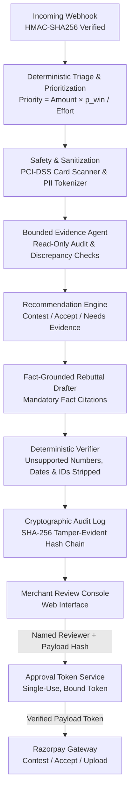

# DisputePilot

> **Human-Approved Chargeback Defense Engine for Razorpay Merchants**

DisputePilot helps Razorpay merchants respond to payment disputes (chargebacks) by triaging incoming claims, auditing supporting fulfillment evidence, and recommending whether to contest or accept liability. It drafts citation-grounded rebuttal letters where unsupported numbers, dates and IDs are stripped by a deterministic verifier against factual order and shipping records. Built with strict safety non-negotiables, DisputePilot requires cryptographically bound human approval before any dispute is contested or accepted.

It now features a **high-conversion Landing Page, Analytics Dashboard, Evidence Locker, Rebuttal Studio, and Cryptographic Audit Chain Verifier** built with React + Vite, backed by an authenticated JSON REST API (`/api/v1`) with cryptographic CSRF protection and HMAC session management.

---

> [!IMPORTANT]
> **Synthetic Data Notice**: All 150 clean + 100 messy synthetic cases, order records, customer communication transcripts, and financial calculations included in this repository were generated by DisputePilot's dispute simulator (`src/disputepilot/sim/`). They do not represent live production merchant data.

---

## ⚡ Quickstart (Setup in 5 Commands)

```bash
# 1. Ensure Python 3.12+ and uv are installed
uv --version

# 2. Sync project dependencies
uv sync

# 3. Build the modern React SPA frontend
make build-frontend
# Or directly:
cd frontend && npm install && npm run build && cd ..

# 4. Run the complete test suite (214 tests passing)
make test
# Or on Windows (without make):
uv run pytest

# 5. Run the code linter (0 errors)
make lint
# Or on Windows (without make):
uv run ruff check src tests

# 6. Launch the full-stack merchant defense web application
make run
# Or on Windows (without make):
uv run uvicorn disputepilot.web:app --reload
```
* **Modern React SPA Console & Landing Page**: [http://127.0.0.1:8000/app](http://127.0.0.1:8000/app)
* **REST API Documentation & Endpoints**: [http://127.0.0.1:8000/api/v1/health](http://127.0.0.1:8000/api/v1/health)
* **Legacy Server-Rendered Console**: [http://127.0.0.1:8000/](http://127.0.0.1:8000/)


---

## 🏗️ System Architecture

DisputePilot follows a linear, deterministic pipeline where sensitive actions are guarded by cryptographic approval gates:



---

## 🛡️ Core Safety Non-Negotiables

| Safety Principle | Implementation Guarantee | Enforced In Code |
| :--- | :--- | :--- |
| **1. Strict Human Approval** | Nothing is submitted or accepted without a single-use human approval token cryptographically bound to the SHA-256 hash of the exact payload. | [`src/disputepilot/razorpay/approval.py`](src/disputepilot/razorpay/approval.py), [`src/disputepilot/razorpay/gateway.py`](src/disputepilot/razorpay/gateway.py) |
| **2. Deterministic Verification** | Every drafted claim must cite verified fact IDs; unsupported numbers, dates and IDs are stripped by a deterministic verifier. | [`src/disputepilot/drafting/verifier.py`](src/disputepilot/drafting/verifier.py), [`src/disputepilot/drafting/facts.py`](src/disputepilot/drafting/facts.py) |
| **3. Bounded Read-Only Agent** | Evidence audit agent has zero mutation permissions and operates within a strict 8-step budget with loop detection. | [`src/disputepilot/agent/orchestrator.py`](src/disputepilot/agent/orchestrator.py), [`src/disputepilot/agent/tools.py`](src/disputepilot/agent/tools.py) |
| **4. PCI-DSS & Privacy Shield** | Card numbers validated via Luhn checksum and redacted immediately; PAN/Aadhaar discarded permanently; PII tokenized with 24h TTL. | [`src/disputepilot/safety/card_scanner.py`](src/disputepilot/safety/card_scanner.py), [`src/disputepilot/safety/pii.py`](src/disputepilot/safety/pii.py), [`src/disputepilot/safety/untrusted.py`](src/disputepilot/safety/untrusted.py) |

---

## 🔒 PCI-DSS & Data Privacy Standards

- **No Cardholder Data Storage**: DisputePilot never stores Primary Account Numbers (PANs) or CVVs in plaintext or ciphertext. 
- **Luhn Algorithm Checksum**: The scanner validates 13–19 digit sequences against the Luhn modulus-10 formula to differentiate real payment cards from AWB tracking numbers or courier IDs.
- **Permanent Redaction of Indian National IDs**: PAN and Aadhaar strings are permanently scrubbed from documents upon ingestion and never stored in the rehydration vault.
- **Untrusted Prompt Fencing**: Customer support logs and uploaded text are wrapped in `<<<UNTRUSTED_CONTENT>>>` security boundaries to prevent prompt injection and instruction overrides.

---

## 📊 Empirical Evaluation Results

Run evaluation anytime with `make eval` (or on Windows: `uv run python -m disputepilot.evals.runner`) (generates [`evals/report.md`](evals/report.md) and [`evals/results.json`](evals/results.json)):

### Results Summary Table

**Tests passing: run uv run pytest (fake LLM, offline)**

| Metric | Clean Set (In-Distribution Rules) | Messy Set (Rules-Only) | Real LLM (Gemini, status: PARTIAL) | Metric Classification |
| :--- | :--- | :--- | :--- | :--- |
| **Reason Code Accuracy** | 100.00% | 6.00% | 15 of 16 | LLM fallback (Gemini), n=16 unique cases |
| **Reason Code Macro-F1** | 100.00% | 9.80% | omitted (sample too small) | LLM fallback (Gemini), n=16 unique cases |
| **Field-Level Extraction Accuracy** | fake regex baseline, appendix only | fake regex baseline, appendix only | n too small (1 document) | fake regex baseline, appendix only |
| **Missing-Category Recall** | 100.00% | 100.00% | N/A (omitted for budget) | **Pipeline sanity check, not performance** |
| **Raw Sentence Grounding Rate** | 100.00% | 100.00% | N/A (omitted for budget) | Pre-verifier fact coverage |
| **Fabricated Claims in Clean Drafts** | **0** | **0** | N/A (omitted for budget) | **Pipeline sanity check, not performance** (verifier check) |
| **Prompt Injection Containment** | 100.00% | 100.00% | N/A (omitted for budget) | Fencing check |
| **PCI-DSS Card Leaks** | **0** | **0** | N/A (omitted for budget) | Deterministic Luhn scanner |
| **Decision Accuracy vs. Winnable** | 88.89% | 72.00% | N/A (omitted for budget) | **Pipeline sanity check, not performance** (heuristic vs sim rules) |
| **DisputePilot Policy Recovery (INR)** | ₹116,783.00* | ₹22,499.00* | N/A (omitted for budget) | Simulated, under assumptions listed here |
| **Uplift vs Contest-All (INR)** | ₹-71,995.00* | ₹-132,373.00* | N/A (omitted for budget) | Simulated, under assumptions listed here |

\* *Simulated under default assumptions (effort cost = ₹0.00, dispute fee = ₹0.00). Whether realistic dispute fees make uplift positive is not tested.*

> **Real LLM Evaluation (Gemini) Notes**:
> - **Evaluation Status**: Overall status is **PARTIAL (classification 16 unique of 30 planned, extraction 1 unique of 5 planned)**. Classification status: **PARTIAL: 16 unique of 30 planned**; Extraction status: **PARTIAL: 1 unique of 5 planned**.
> - **Sample Composition & Origin**: Not a random sample. These 16 unique cases represent the order in which cases left unclassified by rules were encountered during earlier interrupted evaluation runs. Calls were recorded across multiple runs before checkpoint deduplication, yielding 21 total records. When deduplicated by case ID using the rule that the **first completed record is retained**, **5 duplicate records are dropped**, leaving **16 unique cases scored**:
>   1. `disp_m_0096_ul4bkz`, 2. `disp_m_0092_nyhd17`, 3. `disp_m_0088_bi1dls`, 4. `disp_m_0095_7x79m1`, 5. `disp_m_0036_9z8dzt`, 6. `disp_m_0032_8nkm7w`, 7. `disp_m_0094_3499yi`, 8. `disp_m_0084_mqm9sb`, 9. `disp_m_0055_tii54p`, 10. `disp_m_0005_kwo886`, 11. `disp_m_0078_bh400t`, 12. `disp_m_0085_r71yk1`, 13. `disp_m_0093_lob3f2`, 14. `disp_m_0068_446v8y`, 15. `disp_m_0090_l2g3vu`, 16. `disp_m_0058_bmo2fj`.
> - **Classification Performance & Misses**: Across the 16 unique cases, Gemini classified **15 correctly** (15 of 16, 93.75% accuracy). Exactly **1 case was missed**: `disp_m_0005_kwo886` (predicted `unauthorised` with confidence 1.00, true label `subscription_cancelled`, raw reason: *"free trial khatam hote hi bina permission charge lagaya"*). Self-reported confidence is not calibrated (0 answers below the 0.6 threshold).
> - **Extraction Scoring**: 1 document was extracted and scored offline against ground truth: 6 fields returned, all with verbatim source quotes (6 of 6); 2 fields checkable against ground truth (`customer_name`, `total_amount_paise`) and both correct (2 of 2); 4 fields with no ground-truth field in the eval (`invoice_number`, `payment_id`, `billing_address`, `invoice_date`); and 4 nulls (`order_id`, `customer_email`, `customer_phone`, `shipping_address`). Kept as *n too small for an accuracy rate*.
> - **Uncalibrated Win Probability**: The win-probability heuristic is not calibrated. In the empirical evaluation report ([`evals/report.md`](evals/report.md)), cases falling in the 0.4 to 0.6 predicted win-probability bin had an actual win rate of 0.0% (mean predicted $p_{win} = 55.2\%$ on clean hold-out and $49.6\%$ on messy, but 0% actually won).

> **Messy Set Rules-Only Accuracy (6/100 cases, 6.00%) Reconciliation**:
> - Exactly **6 cases** in the 100-case messy dataset are classified correctly under rules-only:
>   - `not_as_described`: **3 cases** (`disp_m_0030_6kyo3i`, `disp_m_0065_nubgae`, `disp_m_0100_y4ols3` — matched keyword `"mismatched"` in `reasons.yaml`)
>   - `other`: **3 cases** (`disp_m_0014_1bz99n`, `disp_m_0077_7veemd`, `disp_m_0098_3mlntq` — matched keyword `"clarification"` in `reasons.yaml`)
>   - All other classes (`item_not_received`, `unauthorised`, `duplicate_charge`, `subscription_cancelled`, `refund_not_received`): **0 cases** (all returned `unclassified`).
>   - Total correct: 3 + 3 = **6 cases**.
> - **17% to 6% Reconciliation**: In an earlier implementation, unclassified disputes silently defaulted to `other`. In the 100-case messy dataset, exactly 14 cases have ground-truth `other`. While 3 of those 14 matched `"clarification"`, the remaining **11 `other` cases** did not match any rule keyword. The silent fallback to `other` accidentally credited those 11 non-matching cases as true positives. Together with 3 keyword matches for `not_as_described` and 3 keyword matches for `other`, this produced 3 + 3 + 11 = 17 cases (17.00%). Enforcing honest `unclassified` classification eliminated those 11 accidental credits, leaving exactly 17 - 11 = 6 cases (6.00%). The numbers reconcile completely.

### Appendix: FakeLLMClient Baseline (fake client written by the same author as the test generator; sanity check only)

Offline test mode runs `FakeLLMClient`, a regex and keyword matching harness written by the author of the simulator. It directly checks for vocabulary found in `sim/messy.py` (e.g. `"parcel gayab"`, `"dusra maal"`, `"maine koi payment nahi kiya"`). Because it uses the generator's exact test vocabulary, its metrics are an offline wiring sanity check only and are omitted from all headline and summary tables. Full per-class tables and calibration are documented in the appendix of [`evals/report.md`](evals/report.md).

---

## 🧪 Razorpay Test-Mode Smoke Test

To verify connectivity and test credentials against Razorpay's API without writing any data, run:

```bash
uv run python scripts/smoke_razorpay.py
```

### Safety & Guardrails
- **Read-Only**: The script only calls `GET /v1/disputes` with `count=5`. It makes **zero mutating or write calls** (no accept, no contest, no document upload).
- **Test Key Guard**: It strictly refuses to run unless `RAZORPAY_KEY_ID` begins with `rzp_test_`.
- **Secret Protection**: It prints only the HTTP status, number of disputes returned, and top-level field names of the first dispute (if any). It never prints raw response bodies or credentials.

### Interpreting Output Honestly
- **Empty List (`Disputes Returned: 0` with `HTTP Status: 200`)**: This means authentication succeeded, but your Razorpay test dashboard currently has no disputes created. This is a normal state for fresh test accounts and should be reported honestly as an empty dispute list, not fabricated or hidden.
- **4xx Error (e.g. `HTTP Status: 401` or `HTTP Status: 403`)**: This indicates invalid credentials, expired API keys, or insufficient permissions on the Razorpay merchant account. 4xx errors identify real integration issues and should be reported honestly rather than suppressed.

---

## ⚠️ Limitations & Security Boundaries

- **Reviewer Identity**: Reviewer role is enforced via session credentials; full enterprise SSO/OIDC integration is recommended for multi-tenant enterprise deployments.
- **CSRF Protection**: State-changing endpoints are fully protected via cryptographic CSRF tokens, verified on every POST/PATCH request.
- **Operational Persistence**: Audit logging, approval tokens, and webhook events use high-concurrency atomic SQLite. For multi-region clustering, a managed PostgreSQL database with row-level locks is recommended.
- **Synthetic Data**: Default test datasets and benchmarks are synthetic, produced by the dispute simulator.
- **Heuristic Recommendation**: The recommendation engine uses transparent, rule-based expected-value formulas aligned with card network regulations.

---

## 🚀 Production Readiness Checklist

Before connecting DisputePilot to live Razorpay webhooks:

1. [ ] **Credentials**: Configure `.env` with `RAZORPAY_KEY_ID`, `RAZORPAY_KEY_SECRET`, and `RAZORPAY_WEBHOOK_SECRET`.
2. [ ] **LLM Activation**: Set `GEMINI_API_KEY` for Google Gemini SDK integration.
3. [ ] **Database Migration**: Switch SQLite storage (`data/*.db`) to managed persistent disk or PostgreSQL.
4. [ ] **TLS & Network**: Terminate TLS at reverse proxy / load balancer for webhook reception.
5. [ ] **Reviewer Identity Provider**: Integrate SSO/OIDC to bind reviewer approvals to verified enterprise corporate identities.

---

## 📖 Key Documentation & Deliverables

- **[Final Independent Verification & Release Audit](FINAL_VERIFICATION_REPORT.md)**
- **[Comprehensive Security & Architecture Audit Report](AUDIT_REPORT.md)**
- **[Record of Applied Fixes & Hardening](FIXES_APPLIED.md)**
- **[Security Regression Test Inventory](SECURITY_TESTS.md)**
- **[Empirical Evaluation Report & Methodology](EVALUATION_REPORT.md)**
- **[Razorpay AI Builders Demo Script & Interview Guide](RAZORPAY_AI_BUILDERS_DEMO.md)**
- **[Production & Sandbox Deployment Guide](DEPLOYMENT.md)**
- **[System Architecture Deep Dive](docs/ARCHITECTURE.md)**

