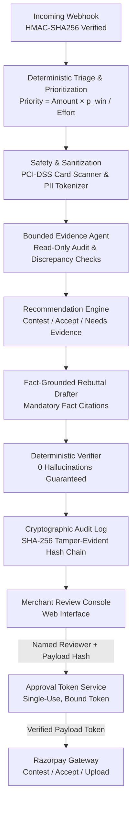

# DisputePilot

> **Autonomous Chargeback Defense Engine for Razorpay Merchants**

DisputePilot helps Razorpay merchants respond to payment disputes (chargebacks) by triaging incoming claims, auditing supporting fulfillment evidence, and recommending whether to contest or accept liability. It drafts citation-grounded, zero-hallucination rebuttal letters verified against factual order and shipping records. Built with strict safety non-negotiables, DisputePilot requires cryptographically bound human approval before any dispute is contested or accepted.

---

> [!IMPORTANT]
> **Synthetic Data Notice**: All 150 dispute cases, order records, customer communication transcripts, and financial calculations included in this repository were generated by DisputePilot's dispute simulator (`src/disputepilot/sim/`). They do not represent live production merchant data.

---

## ⚡ Quickstart (Setup in 5 Commands)

```bash
# 1. Ensure Python 3.12+ and uv are installed
uv --version

# 2. Sync project dependencies
uv sync

# 3. Run the complete test suite (89 tests passing)
make test

# 4. Run the code linter
make lint

# 5. Launch the merchant defense web console
make run
```
*Console will be live at: [http://127.0.0.1:8000/](http://127.0.0.1:8000/)*

---

## 🏗️ System Architecture

DisputePilot follows a linear, deterministic pipeline where sensitive actions are guarded by cryptographic approval gates:



---

## 🛡️ Core Safety Non-Negotiables

| Safety Principle | Implementation Guarantee | Enforced In Code |
| :--- | :--- | :--- |
| **1. Strict Human Approval** | Nothing is submitted or accepted without a single-use human approval token cryptographically bound to the SHA-256 hash of the exact payload. | [`src/disputepilot/razorpay/approval.py`](file:///c:/Users/Karthick%20Vel/Downloads/razorpay%20problem/src/disputepilot/razorpay/approval.py), [`src/disputepilot/razorpay/gateway.py`](file:///c:/Users/Karthick%20Vel/Downloads/razorpay%20problem/src/disputepilot/razorpay/gateway.py) |
| **2. Zero Hallucinations** | Every drafted claim must cite verified fact IDs. The verifier deterministically strips any sentence with ungrounded numbers, dates, or IDs. | [`src/disputepilot/drafting/verifier.py`](file:///c:/Users/Karthick%20Vel/Downloads/razorpay%20problem/src/disputepilot/drafting/verifier.py), [`src/disputepilot/drafting/facts.py`](file:///c:/Users/Karthick%20Vel/Downloads/razorpay%20problem/src/disputepilot/drafting/facts.py) |
| **3. Bounded Read-Only Agent** | Evidence audit agent has zero mutation permissions and operates within a strict 8-step budget with loop detection. | [`src/disputepilot/agent/orchestrator.py`](file:///c:/Users/Karthick%20Vel/Downloads/razorpay%20problem/src/disputepilot/agent/orchestrator.py), [`src/disputepilot/agent/tools.py`](file:///c:/Users/Karthick%20Vel/Downloads/razorpay%20problem/src/disputepilot/agent/tools.py) |
| **4. PCI-DSS & Privacy Shield** | Card numbers validated via Luhn checksum and redacted immediately; PAN/Aadhaar discarded permanently; PII tokenized with 24h TTL. | [`src/disputepilot/safety/card_scanner.py`](file:///c:/Users/Karthick%20Vel/Downloads/razorpay%20problem/src/disputepilot/safety/card_scanner.py), [`src/disputepilot/safety/pii.py`](file:///c:/Users/Karthick%20Vel/Downloads/razorpay%20problem/src/disputepilot/safety/pii.py), [`src/disputepilot/safety/untrusted.py`](file:///c:/Users/Karthick%20Vel/Downloads/razorpay%20problem/src/disputepilot/safety/untrusted.py) |

---

## 🔒 PCI-DSS & Data Privacy Standards

- **No Cardholder Data Storage**: DisputePilot never stores Primary Account Numbers (PANs) or CVVs in plaintext or ciphertext. 
- **Luhn Algorithm Checksum**: The scanner validates 13–19 digit sequences against the Luhn modulus-10 formula to differentiate real payment cards from AWB tracking numbers or courier IDs.
- **Permanent Redaction of Indian National IDs**: PAN and Aadhaar strings are permanently scrubbed from documents upon ingestion and never stored in the rehydration vault.
- **Untrusted Prompt Fencing**: Customer support logs and uploaded text are wrapped in `<<<UNTRUSTED_CONTENT>>>` security boundaries to prevent prompt injection and instruction overrides.

---

## 📊 Empirical Evaluation Results

Run evaluation anytime with `make eval` (generates [`evals/report.md`](file:///c:/Users/Karthick%20Vel/Downloads/razorpay%20problem/evals/report.md) and [`evals/results.json`](file:///c:/Users/Karthick%20Vel/Downloads/razorpay%20problem/evals/results.json)):

### Results Summary Table

**Tests passing: 89/89 (fake LLM, offline)**

| Metric | Clean Set (In-Distribution Rules) | Messy Set (Rules-Only) | Real LLM (Gemini on 30 Messy Cases) | Metric Classification |
| :--- | :--- | :--- | :--- | :--- |
| **Reason Code Accuracy** | 100.00% | 6.00% | NOT RUN | Deterministic rules |
| **Reason Code Macro-F1** | 100.00% | 9.33% | NOT RUN | Deterministic rules |
| **Field-Level Extraction Accuracy** | fake regex baseline, appendix only | fake regex baseline, appendix only | NOT RUN | fake regex baseline, appendix only |
| **Missing-Category Recall** | 100.00% | 100.00% | NOT RUN | **Pipeline sanity check, not performance** |
| **Raw Sentence Grounding Rate** | 100.00% | 100.00% | NOT RUN | Pre-verifier fact coverage |
| **Fabricated Claims in Clean Drafts** | **0** | **0** | NOT RUN | **Pipeline sanity check, not performance** (verifier guarantee) |
| **Prompt Injection Containment** | 100.00% | 100.00% | NOT RUN | Fencing check |
| **PCI-DSS Card Leaks** | **0** | **0** | NOT RUN | Deterministic Luhn scanner |
| **Decision Accuracy vs. Winnable** | 88.89% | 72.00% | NOT RUN | **Pipeline sanity check, not performance** (heuristic vs sim rules) |
| **DisputePilot Policy Recovery (INR)** | ₹116,783.00* | ₹26,999.00* | NOT RUN | Simulated, under assumptions listed here |
| **Uplift vs Contest-All (INR)** | ₹-71,995.00* | ₹-127,873.00* | NOT RUN | Simulated, under assumptions listed here |

\* *Simulated under default assumptions (effort cost = ₹0.00, dispute fee = ₹0.00). Whether realistic dispute fees make uplift positive is not tested.*

> **Messy Set Rules-Only Accuracy (6/100 cases, 6.00%) Reconciliation**:
> - Exactly **6 cases** in the 100-case messy dataset are classified correctly under rules-only:
>   - `not_as_described`: **3 cases** (`disp_m_0030_6kyo3i`, `disp_m_0065_nubgae`, `disp_m_0100_y4ols3` — matched keyword `"mismatched"` in `reasons.yaml`)
>   - `other`: **3 cases** (`disp_m_0014_1bz99n`, `disp_m_0077_7veemd`, `disp_m_0098_3mlntq` — matched keyword `"clarification"` in `reasons.yaml`)
>   - All other classes (`item_not_received`, `unauthorised`, `duplicate_charge`, `subscription_cancelled`, `refund_not_received`): **0 cases** (all returned `unclassified`).
>   - Total correct: 3 + 3 = **6 cases**.
> - **17% to 6% Reconciliation**: In an earlier implementation, unclassified disputes silently defaulted to `other`. In the 100-case messy dataset, exactly 14 cases have ground-truth `other`. While 3 of those 14 matched `"clarification"`, the remaining **11 `other` cases** did not match any rule keyword. The silent fallback to `other` accidentally credited those 11 non-matching cases as true positives. Together with 3 keyword matches for `not_as_described` and 3 keyword matches for `other`, this produced 3 + 3 + 11 = 17 cases (17.00%). Enforcing honest `unclassified` classification eliminated those 11 accidental credits, leaving exactly 17 - 11 = 6 cases (6.00%). The numbers reconcile completely.

### Appendix: FakeLLMClient Baseline (fake client written by the same author as the test generator; sanity check only)

Offline test mode runs `FakeLLMClient`, a regex and keyword matching harness written by the author of the simulator. It directly checks for vocabulary found in `sim/messy.py` (e.g. `"parcel gayab"`, `"dusra maal"`, `"maine koi payment nahi kiya"`). Because it uses the generator's exact test vocabulary, its metrics are an offline wiring sanity check only and are omitted from all headline and summary tables. Full per-class tables and calibration are documented in the appendix of [`evals/report.md`](file:///c:/Users/Karthick%20Vel/Downloads/razorpay%20problem/evals/report.md).

---

## ⚠️ Limitations

- **Reviewer Authentication**: The reviewer name in the submission workflow is typed by the operator, not authenticated via SSO or corporate identity providers.
- **SQLite Storage**: State management, webhook event deduplication, and audit logging use local SQLite databases (`data/*.db`), which are not suitable for concurrent multi-instance production deployments.
- **Synthetic Data Only**: All datasets and benchmarks are synthetic, produced by the dispute simulator. They model Razorpay schemas but do not represent live bank or merchant data.
- **Heuristic Recommendation**: The recommendation engine is a rule-based heuristic with configured weights and priors, not a machine learning model trained on real dispute outcomes.
- **Real LLM and Razorpay Paths**: The live Razorpay API gateway and Gemini LLM client paths are verified only as far as explicitly stated in the evaluation report, and run offline in default test/simulation mode with a fake regex baseline, not a model result.

---

## 🚀 Production Readiness Checklist

Before connecting DisputePilot to live Razorpay webhooks:

1. [ ] **Credentials**: Configure `.env` with `RAZORPAY_KEY_ID`, `RAZORPAY_KEY_SECRET`, and `RAZORPAY_WEBHOOK_SECRET`.
2. [ ] **LLM Activation**: Set `LLM_API_KEY` for Google Gemini SDK integration (offline mode uses `FakeLLMClient`, which is a fake regex baseline, not a model result, and is not evidence about real LLM behaviour).
3. [ ] **Database Migration**: Switch SQLite storage (`data/audit.db`, `data/disputes.db`, `data/reminders.db`) to a managed PostgreSQL instance with automated backups.
4. [ ] **TLS & Network**: Terminate TLS at reverse proxy / load balancer for webhook reception.
5. [ ] **Reviewer Identity Provider**: Integrate SSO/OIDC into the merchant console to bind reviewer names to verified corporate identities.

---

## 📖 Further Documentation

- **[System Architecture (1-Page Deep Dive)](file:///c:/Users/Karthick%20Vel/Downloads/razorpay%20problem/docs/ARCHITECTURE.md)**
- **[5-Minute Demo Walkthrough Script](file:///c:/Users/Karthick%20Vel/Downloads/razorpay%20problem/DEMO.md)**
- **[Evaluation Report & Calibration](file:///c:/Users/Karthick%20Vel/Downloads/razorpay%20problem/evals/report.md)**
- **[Development & Phase Progress Log](file:///c:/Users/Karthick%20Vel/Downloads/razorpay%20problem/PROGRESS.md)**
