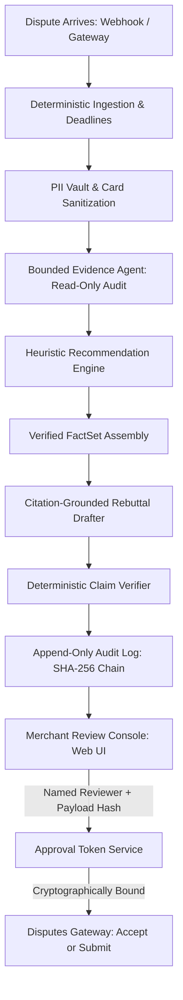

# DisputePilot: System Architecture & Technical Design

DisputePilot is an autonomous defense and decision engine designed for Razorpay merchants to triage, audit, and contest chargebacks while enforcing strict cryptographic and operational safety guarantees.

---

## 1. System Pipeline Overview

DisputePilot operates a linear, bounded, and deterministic processing pipeline (`process_case` in `src/disputepilot/pipeline/orchestrator.py`). The pipeline **strictly never mutates dispute state to `accept` or `submit`** without an explicit human review and cryptographically bound approval token.

---

## 2. Gateway Abstraction (`src/disputepilot/razorpay/`)

The dispute surface communicates through the `DisputesGateway` interface:
1. **`SimGateway`**: Local offline simulation engine reading from `data/cases/` and persisting drafts to `data/drafts/`. Used for local testing and offline evaluations without network dependencies.
2. **`RazorpayGateway`**: Production gateway utilizing `httpx` Basic Authentication against official Razorpay APIs:
   - Disputes API: `GET /v1/disputes`, `GET /v1/disputes/:id`, `POST /v1/disputes/:id/accept`, `PATCH /v1/disputes/:id/contest`.
   - Documents API: `POST /v1/documents` for multipart evidence upload.
   - Idempotency & Retries: Emits both `X-Razorpay-Idempotency-Key` and `Idempotency-Key` on every write; executes exponential backoff on 429 and 5xx; pre-checks dispute status before re-transmitting to prevent duplicate mutations.

---

## 3. Bounded Evidence Agent (`src/disputepilot/agent/`)

The Evidence Agent audits evidence completeness without authority to execute mutating actions:
- **Read-Only Tool Registry**: Provides read access only: `read_order_record`, `read_dispute_record`, `read_refund_record`, `get_extracted_doc`, and `evaluate_requirements`.
- **Strict Step Budget**: Enforces a hard budget (max 8 steps) with loop detection.
- **Cross-Checks**: Detects customer address mismatches, temporal anomalies (delivery timestamps occurring after dispute creation), order amount discrepancies, and duplicate charges.

---

## 4. Grounded Drafting & Deterministic Verifier (`src/disputepilot/drafting/`)

To eliminate LLM hallucinations and prevent false claims in merchant rebuttals:
1. **`FactSet` Assembly**: Extracts atomic, verified facts from verified records (dispute ID, amount, payment ID, courier tracking number, delivery timestamp, customer details).
2. **Citation-Mandated Drafter**: Generates a 4-section rebuttal (Summary, Timeline, Evidence Submitted, Conclusion) where each sentence must explicitly cite `[fact_id]`.
3. **Deterministic Verifier**:
   - Inspects cited fact IDs.
   - Extracts all numbers, dates (ISO and natural text), and alphanumeric identifiers from the sentence text.
   - Verifies that every single number, date, or ID is strictly grounded in the cited facts.
   - Any ungrounded or fabricated sentence is automatically stripped into the audit report.
   - **Guarantee**: Verified final drafts contain **zero fabricated claims**.

---

## 5. Recommendation Math & Calibration (`src/disputepilot/core/recommend.py`)

The recommendation engine combines reason class priors, evidence completeness, cross-check discrepancies, and expected recovery value:
$$\text{Estimated Win Probability } (p_{win}) = \text{Prior}(c) + \Delta_{\text{evidence}} - \Delta_{\text{discrepancies}} + \Delta_{\text{delivery\_boost}}$$
$$\text{Expected Value } (EV) = (p_{win} \times \text{Amount}) - \text{Merchant Effort Cost}$$
- **Configurable Effort Cost**: Defaults to ₹250 (25,000 paise).
- **Uncertainty Band $[0.35, 0.55]$**: Ambiguous cases are flagged as `is_uncertain = True`, suppressing automatic pre-selection and requiring explicit merchant evaluation.
- **Missing Required Evidence**: Automatically routes decision to `NEEDS_EVIDENCE` with tailored operator checklists.

---

## 6. Cryptographic Audit Log & Approval Binding (`src/disputepilot/pipeline/audit.py`, `src/disputepilot/razorpay/approval.py`)

- **Append-Only Tamper-Evident Hash Chain**: Every pipeline and human action records to SQLite (`data/audit.db`) with:
  $$H_i = \text{SHA-256}(H_{i-1} \parallel \text{timestamp} \parallel \text{case\_id} \parallel \text{action} \parallel \text{actor} \parallel \text{details})$$
  Any record modification, deletion, or insertion breaks the chain and is detected by `verify_audit_trail()`.
- **Approval Tokens**: Single-use tokens issued with a 30-minute TTL, bound to the named reviewer and the exact SHA-256 hash of the JSON payload. Mismatched payload hashes raise `ApprovalRequired` immediately.

---

## 7. Safety & Compliance Architecture (`src/disputepilot/safety/`)

1. **Card Sanitization**: Scans 13–19 digit strings using the Luhn checksum and redacts payment card numbers. Luhn-invalid strings (AWB numbers, order IDs) remain intact.
2. **PII Vault**: Replaces names, emails, phones, and UPI IDs with tokens (`[EMAIL_1]`, `[PHONE_1]`). Original PAN and Aadhaar numbers are permanently discarded (never stored in vault).
3. **Untrusted Prompt Fences**: Customer-provided inputs and documents are wrapped in security delimiters (`<<<UNTRUSTED_CONTENT>>>`) to prevent prompt injection and instruction overrides.
